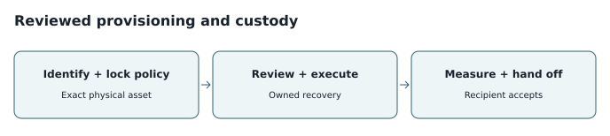

# Operator handbook

This edition describes pxv 0.1.0. It is a general guide, not a certificate for a phone. Only the accepted project record identifies the exact policy, software, checks and custody outcome. Release qualification and physical acceptance must be retained separately.

## First session

Use a dedicated authorized phone and an isolated project. Review the selected policy before connecting a recipient's phone. The shipped one-profile, five-profile and custom-layout packs are structural starters: they contain no invented trusted APK hashes or OS signing keys and are not qualified hardening profiles.

## Prepare the host and project

Install a verified portable archive, Debian package or npm package. A portable archive and Debian package include Node and the Linux supervisor; an npm installation requires Node 24.22.0. A source checkout requires pnpm 12.11.2, the pinned compiler and Rust 1.99.1 with the x86_64-unknown-linux-musl target, rustfmt and Clippy. Prepare Java, the Android SDK and host tools as described in the repository host-dependency instructions.

~~~sh
pnpm install --frozen-lockfile
pnpm quality:setup
pnpm build:native
pnpm build
pnpm quality
pnpm pxv --help
~~~

`pnpm quality:setup` explicitly installs the pinned analysis tools. After dependency and tool setup, `pnpm quality` runs the offline gate: strict type checks, package boundaries, development/production dead-code checks, tests, native process tests and real Android helper checks. Every TypeScript application module, including workers and release tooling, must reach 90% line and 85% branch coverage. TypeScript/JavaScript functions must stay within classic cyclomatic complexity 10, nesting depth 4 and 80 nonblank, noncomment lines. Rust and Java functions have a cyclomatic limit of 10; Rustfmt, Clippy and ShellCheck also run. Current source identity, tool versions and per-module evidence are recorded in `.quality/report.json` and `.quality/report.md`. These checks do not establish live device acceptance.

The remaining examples use an installed command. Create a new directory outside the source checkout:

~~~sh
P="$HOME/pxv-projects/lab"
pxv host doctor
pxv project init --path "$P"
pxv policy validate --project-root "$P"
pxv host adb-start --yes
~~~

Doctor inspects tools and the configured ADB endpoint; it does not start a server or bootstrap a toolchain. See [host dependencies](../../../docs/HOST_DEPENDENCIES.md) for verified downloads and explicit SDK license handling.

## Enroll, review and execute

Enable debugging only for the provisioning session, inspect the phone's USB authorization prompt, and compare the physical asset label, serial, model and codename. Replace the sample serial; never copy one from another phone.

~~~sh
pxv inventory enroll --project-root "$P" --asset lab-01 \
  --serial YOUR_OBSERVED_SERIAL --model 'Pixel 8a' --codename akita --yes
pxv device inspect --project-root "$P" --asset lab-01
pxv device plan --project-root "$P" --asset lab-01
pxv device provision --project-root "$P" --asset lab-01 --operator 'Lab operator'
~~~

Review every generated plan, including global APK effects and manual checkpoints. `--yes` confirms the displayed review in automation; it does not replace a phone's unlock/relock prompt or a human check. OS installation is a separate destructive workflow and needs a pinned, authenticated OS policy.

A pending result means work remains. Perform the exact pending check privately on the phone, record only its named attestation, then use `agent resume --run RUN_ID --yes`. Inspect recovery reservations before retrying a failed or interrupted operation. Finish with fresh signoff, recipient acceptance, debugging shutdown and the custody record described in [operator guide](../../../docs/OPERATOR_GUIDE.md).

## Responsibilities and working boundaries

The operator owns the host, project data, device identification and reviewed policy. The recipient owns final passwords, accounts, MFA and recovery material. Agree the intended uses, allowed profiles, support contact, backup destination and erasure authorization before provisioning. Do not record real credentials in a policy, recipe, screenshot, note, extension input or transcript.

Use the [quickstart](../../../docs/OPERATOR_QUICKSTART.md) to prepare an isolated project. A project contains `pxv.project.json`, `policy.yaml`, `inventory.json`, `policy.lock.json` and a private SQLite database under `state/`. The marker is `format: pxv-ts`. Existing legacy state is retained; this release provides no importer or compatibility execution mode.

## Build a policy for this deployment

Choose a starter and explicitly review OS release/codename/signing key, APK versions/content hashes/signer pins, repository trust anchors, profiles, permission grants, settings, VPN behavior, backup transports and required manual checks. Exactly one owner is required; secondary profiles and their names are policy choices. The five-profile example is optional.

Edit the project's policy, validate it and write its lock before planning. The lock binds the product descriptor, engine identity, policy, project configuration and installed extensions. Duplicate keys, unknown fields, duplicate identities and ambiguous selections are rejected. A changed lock or engine invalidates prior reviews. If project configuration, policy, inventory or the executable changes after loading, the engine refuses the stale context. Reload through a new CLI invocation or fresh MCP request, regenerate the lock when its inputs changed, and prepare a new plan for review. A previously saved approval does not approve edited inputs.

~~~sh
pxv policy validate --project-root "$P"
pxv policy lock --project-root "$P" --yes
pxv inventory list --project-root "$P"
pxv device inspect --project-root "$P" --asset lab-01
~~~

The exact asset `all` is valid. Select it with `--asset all`. A fleet requires explicit `--all` or a group selector; never substitute an asset string for a fleet selector.

## Review and provisioning

Prepare a plan with `device plan` or a workflow's `--dry-run`. Plans bind target identity, transport, current observations, artifact snapshots and device-wide APK effects. Review those effects across every Android user: APK code and version replacement can affect users outside the selected profile.

Run `device provision` for the policy, `device create-users` for profile creation or `device deploy` for app deployment. Each route uses the same verified artifact/install path. A digest alone does not establish publisher identity; verify signer pins from trusted material. Authenticated repositories also enforce signer, age and rollback floors.

~~~sh
pxv device provision --project-root "$P" --asset lab-01 --operator 'Operator'
pxv agent runs --project-root "$P"
pxv agent status --project-root "$P" --run RUN_ID --after 0
~~~

A pending run names its manual checkpoint. Configure only that checkpoint, record a named check, then resume the same approved run. `normal_credentials` must precede final language and optional `duress`. Complete ordinary app setup before language-sensitive final steps. Recipes bind OS fingerprint and exact package version/signer; an unsupported screen stays manual and does not become verified from a tap attempt. A recipe that selects a private staged file checks for an accepted file-selection adapter before launching the app or transferring the file. If unavailable, complete the full import privately through the approved transfer method; no temporary file is left waiting for a later manual selection. If support changes after transfer, owned temporary files are cleaned; a cleanup failure remains an unresolved recovery obligation.

~~~sh
pxv device attest --project-root "$P" --asset lab-01 \
  --check normal_credentials --operator 'Operator' --yes
pxv agent resume --project-root "$P" --run RUN_ID --yes
~~~

If the remaining work outlives its review, run `agent refresh --run RUN_ID`. It prepares a new plan for unfinished work only and returns `planId`, exact `reviewSummary` and `expiresAt`. Save the decoded reviewSummary string exactly in a private file, inspect the new target/actions, then submit `agent execute --plan NEW_PLAN_ID --review-file FILE --operator NAME`. Refresh does not authorize work or replay completed actions, and it is not approval of a changed policy or executable. Reload changed inputs and prepare a fresh review. Interrupted mutations still require inspection/recovery first.

Read the actual pending check list; a policy can require routes, failure tests, backup restore, app setup, recipient acceptance or other supported capabilities. A note cannot override a contradictory measurement. Network-probe evidence covers the probe app UID and reviewed HTTPS endpoints, not every app's traffic.

## Verified OS installation

Install only on a phone explicitly authorized for erasure. Pin the official release's codename, URL, signature URL, OpenSSH principal/namespace and authenticated public key. Attend physical unlock, unlock-state, relock and first-boot checks. Fastboot needs direct USB and an exact serial. Host-ADB-only Docker mode cannot install an OS.

~~~sh
pxv device install-os --project-root "$P" --asset lab-01 --operator 'Operator'
~~~

The reviewed installer verifies image/signature bytes and runs the authenticated script through a serial-forcing fastboot wrapper. Do not bypass an interrupted installation, relock an unverified image or turn an unsigned download into a trusted artifact. Follow the [official GrapheneOS installation instructions](https://grapheneos.org/install/cli) for the device's physical procedure and stop when its state differs from the expected checkpoint.

## Recovery and loss of supervision

Cancellation requests stop future work and clean owned resources where provable; they do not undo an arbitrary flash, account entry or APK change. A native supervisor persists process ownership and completion receipts. An interrupted mutation reserves the physical device and transport across projects, forks and Docker workers.

~~~sh
pxv agent cancel --project-root "$P" --run RUN_ID
pxv device recover --project-root "$P" --asset lab-01
pxv device recover --project-root "$P" --asset lab-01 \
  --run ORIGINAL_RUN_ID --inspected --yes
~~~

Inspect the phone and retained evidence first. Recovery uses stable Android user serial numbers, not reusable IDs/names. A recreated user must remain unresolved. Child probe cleanup must not release a parent workflow's resources. Unproven native cleanup can require a host reboot; manual acknowledgment cannot bypass a live native owner. A cleanup failure is recorded as `blocked`, keeping the unresolved obligation and any native reservation. After inspecting the phone and ownership evidence, retry explicitly through `device recover` and the recorded recovery lineage. Each retry rechecks the original owner scope, device and stable Android user; resolved obligations are not replayed. Never delete a database, lock or receipt to make a blocked device appear ready.

## Signoff and custody

Reboot and check persistence, user isolation, network behavior and a representative restore. Record the policy's checks against fresh observations; the current freshness window is 15 minutes. Finalization remeasures required permissions and settings and refuses drift, outstanding helpers, unresolved cleanup or stale evidence.

~~~sh
pxv device report --project-root "$P" --asset lab-01
pxv device finalize --project-root "$P" --asset lab-01 --operator 'Operator' --locale en
pxv handoff accept --project-root "$P" --asset lab-01 \
  --recipient 'Recipient' --debugging-off --yes
pxv handoff export --project-root "$P" --asset lab-01 --locale en --output "$P/handoff"
pxv handoff export --project-root "$P" --asset lab-01 --locale pl --output "$P/handoff"
~~~

Handoff export uses the accepted product and resolved-policy snapshot, even if the current editable policy has changed. Keep such a packet as historical evidence; it does not establish current readiness. The CLI exports handoff packets as Markdown and HTML. Generic product, operator, user and business guides are rendered from their Markdown sources with `pxv guides rebuild` into HTML plus A4 office and full-color print PDFs; those generic PDFs do not replace an accepted handoff record.

A report describes stored readiness and is not a fresh device attestation. Read the finalization result. Physically confirm debugging toggles are off, remove temporary helpers and transfer custody only after recipient acceptance. Ready-for-handoff, completed-custody, subset and emulator outcomes remain distinct.

## Return visits

Record maintenance, policy changes, loss or retirement through `lifecycle`. These events invalidate prior handoff evidence. Maintenance needs new observations and renewed handoff. Retirement records confirmed erasure and custody; the command does not silently wipe a device. Revoke external accounts/tokens through their owners when a phone is lost.

pxv 0.1.0 is undergoing release qualification. Automated tests, artifact verification and container checks do not certify a policy pack, UI recipe, recipient workflow or physical phone. Verified GrapheneOS emulator evidence, exact-build EN/PL walkthroughs and a physical Pixel 8a acceptance record must be retained before making a deployment claim. A stock Google APIs emulator is useful for compatibility tests and cannot supply GrapheneOS provenance. The current source refactor has offline verification only. Retained Pixel results apply to the candidate named in their record; they do not qualify this refactored build.

## Docker session

Use an explicitly built local image and a dedicated isolated project. Install Docker/USB permissions as a host administrator before provisioning; the toolkit does not grant itself host privileges.

~~~sh
pnpm build:preview --formats oci
pxv host docker-prepare --yes
pxv host docker-adb-start --image YOUR_UNIQUE_IMAGE --yes
pxv host doctor --execution docker --image YOUR_UNIQUE_IMAGE --docker-mode direct
pxv device inspect --project-root "$P" --asset lab-01 \
  --execution docker --image YOUR_UNIQUE_IMAGE --docker-mode direct
pxv device provision --project-root "$P" --asset lab-01 --operator 'Operator' \
  --execution docker --image YOUR_UNIQUE_IMAGE --docker-mode direct
~~~

Replace the image placeholder with the builder's unique local tag. The CLI resolves it to an immutable local ID. The first host commands explicitly prepare private control/key directories and start the independently owned ADB service. Workers use port 5038; they do not start a daemon inside the native mutation group.

Connect the Pixel directly over USB, compare its enrolled identity and accept its host-key prompt on the phone. The container runs as the caller and needs access to the USB device through host permissions and the USB bus mount. A group number is host-specific; Compose's optional USB group must match the host rather than being treated as a universal constant.

OS installation still requires a reviewed OS policy, exact serial and explicit erasure authorization. Follow physical unlock/relock prompts; container access does not bypass them. Use `--dry-run` to inspect a plan before a real workflow.

After interrupted work, inspect shared recovery reservations and the phone before retrying. Stop only the service owned by this operator with `host docker-adb-stop --yes`. See [Docker architecture and Compose](../../../docs/DOCKER.md).

## Private project and publication boundaries

Keep each customer's inventory, SQLite records, credentials-free review files and custody documents outside the installation and outside version control. Registry credentials and ADB keys belong in their external private locations. Fork assets and policy packs contain public templates only. Never package a working project or a real recipient screenshot into a release candidate.

Use exact asset selection for a single phone and explicit fleet selectors for several. Limit jobs to available USB capacity and operator attention. A plan for one device never authorizes another device. Keep an auditable record of the operator, reviewed policy digest, resulting evidence and handoff.

## Extensions and fork identity

Community is free under MIT. Commercial contributions are trusted compiled extensions installed explicitly from exact private registry versions or local tarballs. Extension workers isolate faults, not hostile code. Commands and integration adapters submit typed core actions for ordinary review and recovery. Selecting a new policy pack requires a fresh policy lock and review. Normal work runs offline after installation; registry access is never an implicit part of provisioning.

White-label products are separate forks with their own product descriptor, assets, policy packs and documentation. Preserve the upstream engine marker, API compatibility and safety tests. A logo or product name does not qualify a policy. See the repository's [extension guide](../../../docs/EXTENSIONS.md) and [fork guide](../../../docs/WHITE_LABEL.md).

## Session close checklist

1. Read every pending/manual item and unresolved cleanup obligation.
2. Recheck current observations after reboot and representative restore.
3. Confirm the recipient entered final credentials privately.
4. Remove temporary helpers; verify debugging shutdown physically.
5. Retain the accepted EN/PL handoff snapshot and custody result.
6. Disconnect the phone, stop only the ADB service owned by this operator when appropriate, and protect the private project archive.
7. Record follow-up maintenance or a failed qualification honestly; never label a pending run complete.

## Guidance from the selected policy

Use `pxv guide project --project-root "$P" --locale en --kind pixel` to print profiles, readiness checks and private setup order derived from the current policy; `--kind emulator` selects emulator-specific requirements. `pxv device guided --project-root "$P" --asset lab-01 --operator 'Operator'` presents that guidance and runs the shared provisioning path, returning concrete pending next steps. Its `--dry-run` form prepares review without mutation. The generic operator/recipient guides remain available separately. Guidance never supplies credentials, overrides measurements or turns a manual step into verified completion.
