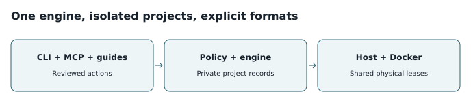

# pxv Community

## A local toolkit for small phone fleets

pxv 0.1.0 helps an operator deploy and inspect small fleets of Google Pixel phones under a reviewed, dedicated policy. Its focus is local provisioning, authenticated artifacts, recovery, evidence and recipient handoff. Community is free under the MIT license. Private commercial repositories can provide compiled extensions without adding a runtime activation service to the Community engine.

This edition describes pxv 0.1.0. It is a general guide, not a certificate for a phone. Only the accepted project record identifies the exact policy, software, checks and custody outcome. Release qualification and physical acceptance must be retained separately.

## What a product maintainer defines

A policy pack describes the intended OS artifact and verification material, Android users, application packages, permissions, settings, networking, backup observations, recipes and manual checks. Exactly one owner profile is required. Other profiles and names depend on the deployment. The reference five-profile pack is one example; simple and arbitrary layouts are also supported.

The included packs are structural starters. They deliberately contain no invented APK digests, OS keys or assertions of live qualification. Before real use, a maintainer must add authentic artifact pins, review the policy and retain acceptance evidence for the exact pack and device build.

A white-label product is a separate fork containing its product descriptor, assets, manifests, defaults, configuration templates, documentation and release identity. It retains the upstream engine/API marker and safety tests so upstream fixes remain mergeable. Changing a brand does not change the host's shared physical-device ownership boundary.

## What the operator does

The operator diagnoses the host, creates an isolated project and enrolls an exact physical asset. A project lock binds the engine, product, policy, configuration, artifacts and extensions. Plans record the target, expected observations and cross-user application effects before any mutation. The operator reviews a concrete plan and completes the policy's manual checkpoints.

OS installation verifies the reviewed image signature and content before running its authenticated installation script through a serial-bound fastboot wrapper. It requires separate erasure authorization, direct USB and physical unlock/relock checks. App installation follows one verified path in the CLI, MCP and provisioning workflows.

Recipes are constrained by OS fingerprint and application version/signer. An unsupported screen remains manual. Private-file recipes check accepted file-selection support before transferring temporary inputs; an unsupported import requires a complete private procedure. Final credentials, accounts, MFA and recovery material are entered privately by the recipient. The expected sequence is normal credentials, final language, then optional duress configuration. Destructive duress activation is never a test step.

## Evidence and completion

Measurements and operator attestations are different evidence. A manual note cannot override a contradictory live permission or setting. The same observation service runs before attestation and finalization. Evidence is bound to the current policy and expires; a policy change, drift, maintenance event or unresolved cleanup invalidates readiness.

A backup setting does not prove a successful restore. A VPN icon does not prove all application traffic. A probe result covers its own UID and reviewed HTTPS endpoints. Actual routes, failure behavior, restore results, user isolation and reboot persistence require the policy's live acceptance checks.

Ready-for-handoff and completed custody are separate outcomes. A branded EN/PL document is generated from an accepted project snapshot and excludes credentials and recovery values. The operator removes temporary helpers, confirms debugging shutdown and records recipient acceptance. Subset and emulator outcomes do not become physical deployment claims.

## Recovery and process ownership

The Linux supervisor owns native mutations through private IPC, kernel locks, process identities, child adoption and durable redacted receipts. Killing a Node process does not imply that a device command completed or cleanup succeeded. Device and transport reservations are shared across projects, forks, previews and Docker workers. Concurrent control from several workstations is unsupported.

Interrupted work is never automatically replayed. Recovery checks the retained record, native ownership and stable Android user serial numbers. A replacement user with a reused ID/name is not the original cleanup target. Child operations own only their own resources. Failed cleanup remains blocked until an explicit inspected retry verifies that ownership and stable user identity still match; resolved obligations are not replayed. Unproven cleanup keeps the fence and can require a host reboot and physical inspection.

## Extensions

The versioned SDK allows commands, policy packs, guides and integration adapters. Extensions are trusted executable code. Worker separation provides fault isolation rather than a security sandbox. Device-changing contributions return typed actions through core planning, approval, execution and recovery.

Installation is explicit and exact-versioned. The lock records package integrity. Private registry authentication stays outside projects and releases. Local tarballs support testing. Installed bundles have no lifecycle scripts or runtime dependency resolution, and normal operation works offline. No extension is fetched or updated implicitly.

## Installation formats and local previews

The initial application platform is Linux x86_64, with Debian 12 and Ubuntu 24.04 as validation targets. Node 24.22.0 LTS, TypeScript compiler 7.0.2 and pnpm 12.11.2 are pinned. The portable archive and Debian package bundle Node and the Linux supervisor. The npm-compatible package requires the supported Node installation. Docker includes its runtime tools.

An immutable candidate supplies portable, Debian, npm and OCI formats. Previews accept a dirty source tree, record its content digest and use unique versions, directories, package/command names and image tags. Ordinary build commands never publish, push, install globally or replace a stable launcher. Promotion is separate and explicit. A single executable remains experimental; the portable archive is the supported no-Node baseline.

Host operation validates Android, Java and OpenSSH tools and offers explicit verified bootstrap. Docker runs as the caller with persistent private ADB keys, shared leases and read-only extensions. Direct USB and host-ADB modes are explicit; fastboot needs direct USB. An independent ADB server is started deliberately rather than as a worker side effect.

## Lifecycle and limits

Maintenance creates fresh evidence and renewed handoff. Policy changes invalidate previous signoff. Loss records support the operator's response but do not remotely wipe a phone. Retirement records separately confirmed erasure and custody without silently triggering a wipe. Community is a local toolkit, not a remote MDM server. Headwind integration and custom OS source builds remain later, separately qualified workflows.

Offline unit, cryptographic, storage, process, extension and packaging tests support confidence in the engine. They do not certify a UI recipe, policy pack or physical phone. Release qualification requires recorded GrapheneOS emulator provenance and authorized Pixel 8a EN/PL acceptance including restore, reboot, routing/failure recovery and custody. A stock emulator cannot provide GrapheneOS provenance. The current source refactor has offline verification only. Historical Pixel checks remain evidence for their recorded candidate and do not qualify a newer build.

## Start here

Operators should use the operator handbook and current CLI help. Recipients should use the recipient handbook together with their exact accepted handoff. Maintainers should read the repository architecture, extension, fork and publication documentation. Keep private working projects and secrets outside public fork assets and release candidates.
