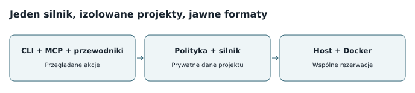

# pxv Community

## Lokalny toolkit dla małych flot telefonów

pxv 0.1.0 pomaga operatorowi wdrażać i sprawdzać małe floty Google Pixel według dedykowanej, przeglądanej polityki. Obejmuje lokalne przygotowanie, uwierzytelnione artefakty, odzyskiwanie, dowody i przekazanie odbiorcy. Community pozostaje bezpłatne na licencji MIT. Komercyjne rozszerzenia mogą być rozwijane prywatnie i dystrybuowane przez uwierzytelniony rejestr bez serwera aktywacji silnika.

Ten przewodnik opisuje pxv 0.1.0. Nie jest certyfikatem telefonu. Dopiero zaakceptowany zapis projektu wskazuje konkretną politykę, oprogramowanie, wyniki sprawdzeń i przekazanie urządzenia. Dowody kwalifikacji wydania oraz testów fizycznego telefonu przechowuje się oddzielnie.

## Polityka produktu i fork

Pakiet polityki określa obraz OS i zaufane materiały weryfikacyjne, użytkowników Androida, aplikacje, uprawnienia, ustawienia, sieć, obserwacje kopii, receptury i kontrole ręczne. Wymagany jest dokładnie jeden właściciel. Pozostałe profile i ich nazwy zależą od wdrożenia. Pakiet referencyjny z pięcioma profilami jest przykładem, a nie stałym ograniczeniem architektury.

Każdy profil, także właściciela, może zawierać opcjonalne `defaultLocale`: na przykład właściciel `en-US`, praca `pl-PL`, podróże `de-DE`. Jeden kanoniczny znacznik BCP 47 określa język, region i alfabet. Starsze pole `language` nadal działa, a sprzeczne wartości obu pól są odrzucane. Ustawienie nie zmienia strefy czasowej ani języka EN/PL dokumentów. Przygotowanie ustawia język zaakceptowanym adapterem UI albo ręcznym krokiem po zwykłych danych uwierzytelniających i przed opcjonalnym duress.

Dołączone pakiety pokazują strukturę. Nie zawierają zmyślonych skrótów APK, kluczy OS ani deklaracji testów na urządzeniu. Przed realnym zastosowaniem maintainer musi dodać autentyczne przypięcia, przejrzeć politykę i zachować akceptację konkretnego pakietu oraz wersji telefonu.

Produkt white-label to osobny fork z własnym deskryptorem, zasobami, manifestami, konfiguracją, dokumentacją i tożsamością wydania. Zachowuje marker silnika/API oraz testy bezpieczeństwa, aby można było scalać poprawki upstream. Inne logo nie zmienia współdzielonej granicy własności fizycznego urządzenia na hoście ani nie stanowi kwalifikacji polityki.

## Praca operatora

Operator sprawdza host, tworzy prywatny izolowany projekt i rejestruje dokładny zasób fizyczny. Blokada projektu wiąże silnik, produkt, politykę, konfigurację, artefakty i rozszerzenia. Plan utrwala cel, oczekiwane obserwacje oraz skutki aplikacji dla wszystkich użytkowników przed zmianą telefonu. Zatwierdza się konkretny plan.

Instalacja OS sprawdza podpis i treść obrazu przed uruchomieniem uwierzytelnionego skryptu przez wrapper fastboot związany z numerem telefonu. Wymaga oddzielnej zgody na wymazanie, bezpośredniego USB oraz fizycznej kontroli odblokowania i ponownego zablokowania. CLI, MCP i pełne przygotowanie korzystają z jednej ścieżki weryfikowanej instalacji aplikacji.

Receptury są przypięte do odcisku OS oraz wersji i podpisu aplikacji. Nieobsługiwany ekran pozostaje zadaniem ręcznym. Receptura z prywatnym plikiem sprawdza zaakceptowaną obsługę wyboru pliku przed przesłaniem danych tymczasowych; nieobsługiwany import wymaga pełnej prywatnej procedury. Odbiorca prywatnie ustawia zwykłą blokadę lub sprawdza lub zmienia nadane wartości początkowe, a także prywatnie wprowadza konta, MFA i dane odzyskiwania. Kolejność to zwykłe dane uwierzytelniające, język końcowy i opcjonalny duress. Destrukcyjna aktywacja duress nigdy nie jest krokiem testowym.

## Dowody i zakończenie

Pomiary i poświadczenia człowieka są odrębnymi dowodami. Notatka nie może zastąpić pomiaru, który przeczy wymaganemu uprawnieniu lub ustawieniu. Przed poświadczeniem i finalizacją działa wspólna usługa obserwacji. Dowody wiążą się z aktualną polityką i tracą świeżość. Zmiana polityki, dryf, serwis albo nierozwiązane sprzątanie unieważniają gotowość.

Włączony backup nie potwierdza odtworzenia; ikona VPN nie potwierdza całego ruchu. Wynik helpera sieciowego dotyczy własnego UID i zatwierdzonych adresów HTTPS. Faktyczne aplikacje, awarie trasy, restore, izolacja i trwałość po restarcie wymagają sprawdzeń na żywo.

Gotowość do przekazania i zakończona piecza to osobne wyniki. Dokument EN/PL z brandingiem powstaje z zaakceptowanego snapshotu i nie zawiera haseł ani wartości odzyskiwania. Operator usuwa helpery, potwierdza wyłączenie debugowania i zapisuje akceptację odbiorcy. Wynik częściowy lub emulator nie staje się deklaracją fizycznego wdrożenia.

## Odzyskiwanie i procesy

Nadzorca Linux zarządza mutacjami przez prywatne IPC, blokady jądra, tożsamość procesów, adopcję potomków i trwałe zredagowane pokwitowania. Zabicie Node nie dowodzi zakończenia polecenia ani sprzątania. Rezerwacje urządzenia i transportu są wspólne dla projektów, forków, buildów próbnych i kontenerów. Kontrola jednego telefonu z kilku stacji równocześnie jest nieobsługiwana.

Przerwane mutacje nie są odtwarzane automatycznie. Odzyskiwanie sprawdza zapis, właściciela natywnego i stabilne numery seryjne użytkowników Androida. Nowy użytkownik z powtórzonym ID i nazwą nie jest poprzednim celem sprzątania. Podoperacja posiada tylko własne zasoby. Nieudane sprzątanie pozostaje zablokowane do jawnej, poprzedzonej inspekcją próby, która ponownie sprawdza zakres właściciela i stabilnego użytkownika. Rozwiązane zobowiązania nie są odtwarzane. Brak dowodu sprzątania zachowuje rezerwację; może wymagać restartu hosta i inspekcji.

## Rozszerzenia

Wersjonowany SDK udostępnia komendy, pakiety polityki, przewodniki i adaptery integracyjne. Rozszerzenia są zaufanym wykonywalnym kodem. Worker izoluje awarie, ale nie jest piaskownicą dla wrogiego kodu. Zmiany telefonu przechodzą przez typowane akcje planowania, zatwierdzania, wykonania i odzyskiwania silnika.

Instalacja jest jawna i przypięta do dokładnej wersji oraz integralności. Dane uwierzytelniające rejestru pozostają poza projektem i wydaniami. Lokalne tarballe służą do testów. Instalator nie uruchamia skryptów lifecycle ani nie rozwiązuje zależności w czasie pracy. Po instalacji zwykłe działanie jest offline; aktualizacja nigdy nie zachodzi niejawnie.

## Dystrybucja i wersje próbne

Początkowa platforma to Linux x86_64, z docelową weryfikacją na Debianie 12 i Ubuntu 24.04. Przypięto Node 24.22.0 LTS, kompilator TypeScript 7.0.2 i pnpm 12.11.2. Archiwum przenośne i pakiet Debian zawierają runtime oraz nadzorcę. Pakiet npm wymaga obsługiwanego Node. Docker zawiera narzędzia wykonawcze.

Jeden niezmienny kandydat stanowi źródło formatów portable, Debian, npm i OCI. Build próbny dopuszcza niezacommitowane zmiany, zapisuje skrót treści i używa unikalnej wersji, katalogu, komendy/pakietu Debian oraz tagu obrazu. Zwykłe budowanie niczego nie publikuje, nie instaluje globalnie i nie zastępuje stabilnego launchera. Promocja jest oddzielna i jawna. Pojedynczy plik wykonywalny pozostaje eksperymentem; archiwum portable jest obsługiwanym wariantem bez zewnętrznego Node.

Host sprawdza Android, Java i OpenSSH oraz udostępnia jawny weryfikowany bootstrap. Docker działa jako operator, używa trwałych prywatnych kluczy ADB, wspólnych rezerwacji i rozszerzeń tylko do odczytu. Tryby bezpośredniego USB i host-ADB są jawne; fastboot wymaga USB. Niezależny serwer ADB uruchamia się świadomie, poza workerem.

## Cykl życia i ograniczenia

Serwis zbiera nowe dowody i odnawia przekazanie. Zmiana polityki unieważnia poprzednie zatwierdzenia. Zapis utraty wspiera reakcję, ale nie wymazuje zdalnie. Wycofanie dokumentuje osobno potwierdzone wymazanie oraz pieczę, bez niejawnego wipe. Community jest lokalnym toolkitem, a nie zdalnym MDM. Headwind i budowanie własnego OS to późniejsze, osobno kwalifikowane integracje.

Testy jednostkowe, kryptograficzne, procesów, bazy, rozszerzeń i pakowania wspierają wiarygodność silnika. Nie certyfikują receptury UI, polityki ani telefonu. Kwalifikacja wymaga zachowanego pochodzenia emulatora GrapheneOS i autoryzowanego Pixel 8a w EN/PL, w tym restore, restartu, trasowania/awarii i przekazania. Zwykły emulator nie dowodzi pochodzenia GrapheneOS. Bieżący refaktoring źródeł ma wyłącznie weryfikację offline. Historyczne sprawdzenia Pixel dotyczą zapisanego kandydata i nie kwalifikują nowszego buildu.

Operator powinien korzystać z podręcznika operatora i aktualnego help CLI. Odbiorca otrzymuje podręcznik wraz z zaakceptowanym dokumentem własnego telefonu. Maintainer korzysta z dokumentacji architektury, rozszerzeń, forków i publikacji. Prywatne projekty oraz sekrety pozostają poza publicznymi zasobami wydania.
