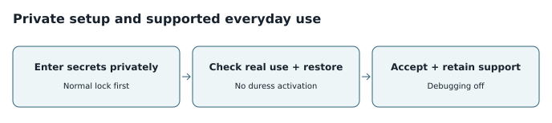

# Recipient handbook

This edition describes pxv 0.1.0. It is a general guide, not a certificate for a phone. Only the accepted project record identifies the exact policy, software, checks and custody outcome. Release qualification and physical acceptance must be retained separately.

## Your first session

Your phone follows a policy selected by your provider. Profile names, allowed applications and available services vary; five profiles are not mandatory. Keep your provider's support details and the device's public asset label.

1. Review which profile is intended for each activity and how to switch users.
2. Enter your own normal screen lock privately. Do not give the operator passwords, MFA secrets, recovery words or the final lock code.
3. Complete the agreed app/account setup, then select your final language.
4. If your policy includes a duress credential, configure it only after the normal credential and language steps. Never test destructive duress activation.
5. Check ordinary calling/network/app behavior with the operator, including what happens when the approved network path fails.
6. Confirm a representative backup restore and understand where your recovery material is stored outside the phone.
7. Review the handoff record, verify temporary helpers are removed and physically confirm debugging is off before accepting custody.

A ready-for-handoff record is not the same as a completed custody transfer. Ask the operator to explain every unresolved item. Do not accept a device based only on a screenshot, a successful install message or a printed generic guide.

Keep the phone updated through the agreed maintenance process and contact support before changing system/profile/network policy. If the phone is lost, use your provider's loss procedure and revoke accounts/tokens through their respective services. See [full user guide](../../../docs/USER_GUIDE.md) and [FAQ](../../../docs/USER_FAQ.md).

## Using and maintaining your phone

## What the phone provides

Your provider chooses a policy for your intended use. It can divide activities into Android users/profiles, install pinned applications and require specific network or backup settings. Application code updates can affect several users even when their data is separated. Ask which tasks belong in each profile and which changes require a maintenance visit.

A hardened configuration reduces particular risks; it cannot guarantee anonymity, protection against every attacker or recovery of data that was never backed up. Certification applies only to the exact pack, software build and checks in your accepted handoff record. Community starter packs are demonstrations of structure.

## Private setup and credentials

Set the normal screen lock yourself while the operator gives you privacy. Enter accounts, MFA and recovery information on the phone or through the service's approved recovery process. Do not put these values in an operator's notes, a chat, a guide annotation, a repository or an unapproved photo.

Finish normal credentials before final language selection and any optional duress configuration. Duress is an optional policy capability with potentially destructive consequences. Never enter a duress credential to see whether it works. Ask your provider how to avoid confusing ordinary and duress credentials and how to handle replacement or retirement safely. The [official GrapheneOS usage guide](https://grapheneos.org/usage) is a primary reference for device features; follow the exact instructions for your installed build.

## Profiles and applications

Learn the owner/secondary-profile layout actually delivered to you. Different users can have different apps and settings. Restarting or ending a user's session may affect which apps run in the background. Follow your provider's demonstrated procedure instead of assuming another Android model's menus are identical.

Install or remove applications only through the agreed policy. A new source, signer or version may invalidate qualification. Report unexpected permissions, accessibility prompts, administrator requests or app behavior before accepting them.

## Network and backup

Understand which VPN/routing arrangement applies to each profile. A VPN icon does not establish all traffic behavior. Ask for a demonstration of the intended route and agreed failure behavior for your actual applications. If connectivity fails, use support's recovery procedure; switching settings at random may change the policy.

Know what is backed up, where it is kept, how it is encrypted and what a successful restore looked like. Keep recovery material outside the phone. A backup-enabled switch is not proof of a usable backup. Test representative restoration before relying on a new device or a new destination.

## Acceptance and everyday use

Before custody transfer, verify the asset label, chosen language, required profiles, expected apps, contact/support information and agreed live checks. Confirm temporary setup/probe helpers are gone and debugging toggles are off. Retain the EN or PL handoff document; it deliberately excludes device credentials and recovery values.

Arrange maintenance before policy changes, replacing network services or moving recovery destinations. Maintenance produces new evidence and a renewed handoff. If the device is lost, tell support promptly and revoke affected services; a local loss record does not remotely wipe it. At retirement, follow a separately authorized erasure and custody process and retain confirmation.

pxv 0.1.0 is undergoing release qualification. Automated tests, artifact verification and container checks do not certify a policy pack, UI recipe, recipient workflow or physical phone. Verified GrapheneOS emulator evidence, exact-build EN/PL walkthroughs and a physical Pixel 8a acceptance record must be retained before making a deployment claim. A stock Google APIs emulator is useful for compatibility tests and cannot supply GrapheneOS provenance.

## Questions to resolve before accepting the device

Ask your provider to write down the public asset label, support contact, intended profile for each activity, approved update process, backup destination and agreed failure procedure. These are operational details, not passwords. A generic printed guide cannot tell you which exact software and policy were installed: retain your device's accepted handoff document.

Practise an ordinary unlock, a restart, switching the intended users, launching your essential applications and obtaining support. Demonstrate ordinary network use and the agreed failure behavior with the operator. Check that you can recover representative data from your backup without exposing recovery material. Do not activate a destructive duress function as a demonstration.

If a required application or account is not ready, ask the operator to record the unresolved item. A pending setup should not be described as a completed custody transfer. The right response may be a follow-up visit or a policy decision rather than an improvised change.

## Everyday checklist

- Keep the phone under your control and use its normal lock.
- Follow the approved update and installation process.
- Notice unexpected permission, administrator or accessibility requests.
- Check that important backups continue and keep recovery material separately.
- Arrange support before changing profile, VPN, account or recovery arrangements.
- Report loss promptly and use the service providers' account-revocation procedures.

## Questions and answers

**Do all phones have five profiles?** No. The product's policy determines the layout. The repository includes owner-only, five-profile and arbitrary-layout starters.

**Does a successful command mean the phone is ready?** No. Runs can be pending or need inspection, and a stored report is not a fresh live check. Acceptance needs the policy's measurements, human checks, helper cleanup, debugging shutdown and custody record.

**Should I tell the operator my final password?** No. Enter final lock/account/MFA/recovery material privately. Support should not need those values in project state, logs or screenshots.

**Can I test my duress code?** Do not test destructive duress activation. It is an optional sensitive feature; get the exact approved procedure from your provider and keep it separate from normal unlock behavior.

**Is a VPN icon enough?** No. Routing and failure behavior must be checked for the intended applications and profiles. A probe helper's result only covers its reviewed scope.

**Are backups guaranteed?** No. A configured transport is not a successful restoration. Agree a representative restore test and protect recovery material outside the phone.

**Can I change the policy or install any app?** Ask your provider. OS/app/policy changes can invalidate the accepted evidence and affect more than one user.

**Does Community require a license server?** No. Community is free under MIT. Commercial extensions are distributed through private repositories/registries and have no engine runtime activation check.

**Can support remotely manage or wipe my phone?** The Community local toolkit does not itself provide remote MDM. Any separately deployed integration must be explained and authorized as part of the product's policy.

**What if I lose the phone?** Follow the provider's loss process and revoke accounts/tokens with the service owners. Do not assume a local loss record erased the device.

## Return, replacement and retirement

At a maintenance visit, the operator gathers fresh observations and renews the handoff. If a new phone replaces this one, confirm that data restoration and the new device's acceptance are complete before disposing of the old phone. Follow an explicitly authorized erasure procedure and keep the erasure/custody confirmation. A retirement record alone does not wipe hardware.

Never send a lock code, password, MFA seed or recovery phrase to support through a project attachment or chat. Ask for a recovery process that preserves your privacy.
