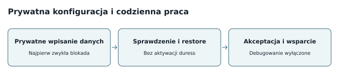

# Podręcznik odbiorcy

Ten przewodnik opisuje pxv 0.1.0. Nie jest certyfikatem telefonu. Dopiero zaakceptowany zapis projektu wskazuje konkretną politykę, oprogramowanie, wyniki sprawdzeń i przekazanie urządzenia. Dowody kwalifikacji wydania oraz testów fizycznego telefonu przechowuje się oddzielnie.

## Pierwsze spotkanie

Telefon działa według polityki wybranej przez dostawcę. Nazwy profili, dozwolone aplikacje i usługi mogą się różnić. Pięć profili nie jest obowiązkowym układem. Zachowaj publiczną etykietę urządzenia, kontakt do wsparcia i dokument przekazania właściwy dla tego telefonu.

1. Ustal przeznaczenie każdego profilu i przećwicz przełączanie użytkowników.
2. Samodzielnie i prywatnie ustaw zwykłą blokadę ekranu. Nie przekazuj operatorowi kodu końcowego, haseł, MFA ani danych odzyskiwania.
3. Dokończ uzgodnioną konfigurację aplikacji i kont, a potem wybierz język końcowy.
4. Jeśli polityka obejmuje duress, konfiguruj go dopiero po zwykłych danych i języku. Nigdy nie uruchamiaj destrukcyjnego duress jako testu.
5. Sprawdź zwykłe połączenia i aplikacje oraz zachowanie przy awarii zatwierdzonej sieci.
6. Potwierdź reprezentatywne odtworzenie kopii i miejsce przechowywania danych odzyskiwania poza telefonem.
7. Obejrzyj zapis przekazania, brak tymczasowych helperów i fizycznie wyłączone debugowanie.

Gotowość do przekazania nie jest jeszcze przyjęciem urządzenia. Każdy brak musi być wyjaśniony. Nie przyjmuj telefonu wyłącznie na podstawie zrzutu ekranu, komunikatu o instalacji lub ogólnego drukowanego przewodnika.

## Co zapewnia konfiguracja

Polityka może oddzielać działania przez użytkowników Androida, przypinać wersje aplikacji i wymagać ustawień sieci lub kopii. Ogranicza określone ryzyka, ale nie gwarantuje anonimowości, ochrony przed każdym przeciwnikiem ani odzyskania danych bez kopii. Ważne są konkretna wersja OS, aplikacje, polityka i sprawdzenia w zaakceptowanym dokumencie. Pakiety przykładowe Community pokazują strukturę.

Zapytaj, jakie zadania wykonuje się w każdym profilu, jakie zmiany wymagają wizyty oraz jak otrzymać pomoc. Aktualizacja kodu aplikacji może dotyczyć kilku użytkowników mimo oddzielenia ich danych. Nie zakładaj, że instrukcja z innego modelu Androida ma identyczne menu.

## Sekrety należą do Ciebie

Ustaw zwykłą blokadę przy zapewnionej prywatności. Konta, MFA i dane odzyskiwania wpisuj na telefonie lub w zatwierdzonym procesie danej usługi. Nie dopisuj ich do przewodnika, notatki operatora, repozytorium, rozmowy ze wsparciem ani niezatwierdzonego zdjęcia. Wsparcie nie powinno potrzebować tych wartości w załączniku projektu.

Jeżeli przygotowanie przekazuje Ci ręczne zadanie importu, plik tymczasowy nie pozostaje do późniejszego wyboru. Poproś o pełną zatwierdzoną procedurę prywatnego transferu i importu. Prywatna konfiguracja nie należy do rozmów ze wsparciem ani załączników projektu.

Ustal sposób przechowywania danych odzyskiwania poza telefonem. Oddziel informacje pozwalające odblokować urządzenie od samego urządzenia. Jeśli potrzebna jest pomoc w odzyskaniu dostępu, poproś o procedurę chroniącą prywatność.

Najpierw kończy się zwykłe dane, potem język, a następnie opcjonalną konfigurację duress. Duress może mieć destrukcyjne skutki. Nie wpisuj takiego kodu, żeby sprawdzić działanie. Poproś dostawcę o dokładną instrukcję unikania pomyłek oraz bezpiecznej wymiany i wycofania telefonu. Korzystaj z oficjalnych instrukcji GrapheneOS dla rzeczywiście zainstalowanej wersji.

## Profile i aplikacje

Naucz się układu właściciela i pozostałych użytkowników, który faktycznie otrzymujesz. Każdy może mieć inne aplikacje i ustawienia. Zakończenie sesji lub restart może zmieniać pracę w tle. Przećwicz normalne odblokowanie, restart, zmianę użytkownika i uruchomienie potrzebnych aplikacji.

Instaluj i usuwaj aplikacje według uzgodnionej polityki. Nowe źródło, podpis lub wersja mogą unieważnić sprawdzenia. Zgłaszaj niespodziewane prośby o uprawnienia, dostępność, administratora urządzenia lub nietypowe działanie aplikacji przed ich zaakceptowaniem.

## Sieć i kopie

Ustal, jaka konfiguracja VPN i trasowania obowiązuje w każdym profilu. Ikona VPN nie potwierdza całego ruchu. Poproś o demonstrację właściwej trasy i uzgodnionego zachowania przy awarii w używanych aplikacjach. Wynik sondy operatora ma ograniczony zakres i nie zastępuje tych sprawdzeń.

Gdy połączenie przestaje działać, stosuj procedurę wsparcia. Przypadkowe przełączanie ustawień może zmienić politykę. Zapisz sposób kontaktu ze wsparciem, gdy podstawowa ścieżka sieciowa jest niedostępna, bez dopisywania sekretów.

Dowiedz się, co jest kopiowane, dokąd, jak jest szyfrowane i jak wyglądało poprawne odtworzenie. Sam włączony transport backup nie gwarantuje dostępnej kopii. Sprawdź reprezentatywne dane przed poleganiem na nowym telefonie lub miejscu kopii. Chroń dane odzyskiwania poza urządzeniem i okresowo potwierdzaj kontynuację kopii.

## Akceptacja i codzienna praca

Przed przyjęciem telefonu sprawdź etykietę, język, wymagane profile, oczekiwane aplikacje, dane wsparcia oraz uzgodnione testy. Potwierdź brak tymczasowych aplikacji przygotowawczych i sond oraz wyłączenie debugowania. Dokument EN lub PL nie zawiera haseł ani wartości odzyskiwania.

Jeśli konto lub wymagana aplikacja nie są gotowe, poproś o zapisanie braku. Oczekujące przygotowanie nie powinno być nazywane zakończonym przekazaniem. Rozwiązaniem może być kolejna wizyta albo decyzja o polityce, zamiast doraźnej zmiany bez przeglądu.

Na co dzień zachowuj kontrolę nad telefonem, używaj normalnej blokady, stosuj proces aktualizacji i zwracaj uwagę na nowe monity. Umów serwis przed zmianą polityki profili, VPN, kont lub miejsc odzyskiwania. Serwis zbiera nowe dowody i kończy się ponownym przekazaniem.

## Częste pytania

**Czy każdy telefon ma pięć profili?** Nie. Układ określa polityka. Dostępne są przykłady z jednym, pięcioma i dowolnym układem.

**Czy poprawne zakończenie polecenia wystarcza?** Nie. Przebieg może oczekiwać na kontrolę, a zapisany raport nie jest świeżym badaniem. Wymagane są pomiary, czynności ręczne, usunięcie helperów, wyłączenie debugowania i przyjęcie urządzenia.

**Czy podać operatorowi końcowe hasło?** Nie. Dane blokady, kont, MFA i odzyskiwania wprowadzasz prywatnie.

**Czy testować duress?** Nie uruchamiaj destrukcyjnej funkcji. Uzyskaj dokładną zatwierdzoną procedurę.

**Czy backup jest gwarantowany?** Nie. Liczy się sprawdzone odtworzenie i chronione dane odzyskiwania.

**Czy Community wymaga serwera licencji?** Nie. Community jest bezpłatne na MIT. Komercyjne rozszerzenia są dystrybuowane prywatnie, bez aktywacji silnika w czasie pracy.

**Czy operator ma zdalne MDM i wipe?** Sam lokalny toolkit Community ich nie zapewnia. Osobna integracja musi być wyjaśniona i autoryzowana w polityce produktu.

## Utrata, wymiana i wycofanie

W razie utraty szybko powiadom wsparcie i odwołaj odpowiednie konta lub tokeny u właścicieli usług. Lokalny wpis o utracie nie oznacza zdalnego wymazania. Nie zakładaj, że samo zgłoszenie usunęło dane z telefonu.

Przed pozbyciem się starego urządzenia przy wymianie potwierdź odtworzenie danych i akceptację nowego. Przy wycofaniu stosuj osobno zatwierdzoną procedurę wymazania oraz przekazania pieczy i zachowaj potwierdzenie. Sam wpis o wycofaniu nie uruchamia wipe.

## Zakres tego wydania

pxv 0.1.0 przechodzi kwalifikację wydania. Testy automatyczne i poprawnie zbudowany kontener nie certyfikują polityki, receptury UI ani fizycznego telefonu. Potrzebne są zapisane dowody GrapheneOS emulatora i autoryzowanego Pixel 8a w EN/PL obejmujące restore, restart, izolację, routing, awarie oraz przekazanie. Zwykły emulator nie stanowi dowodu pochodzenia GrapheneOS.
